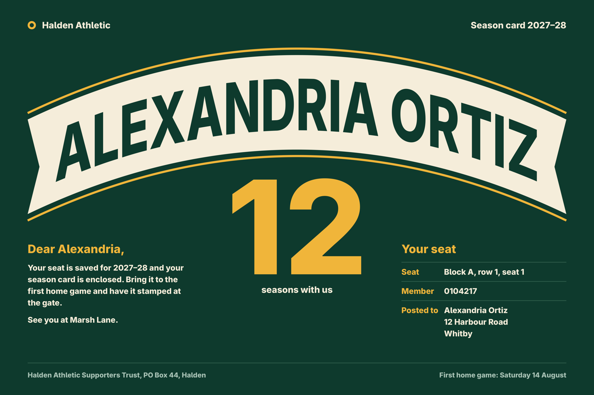
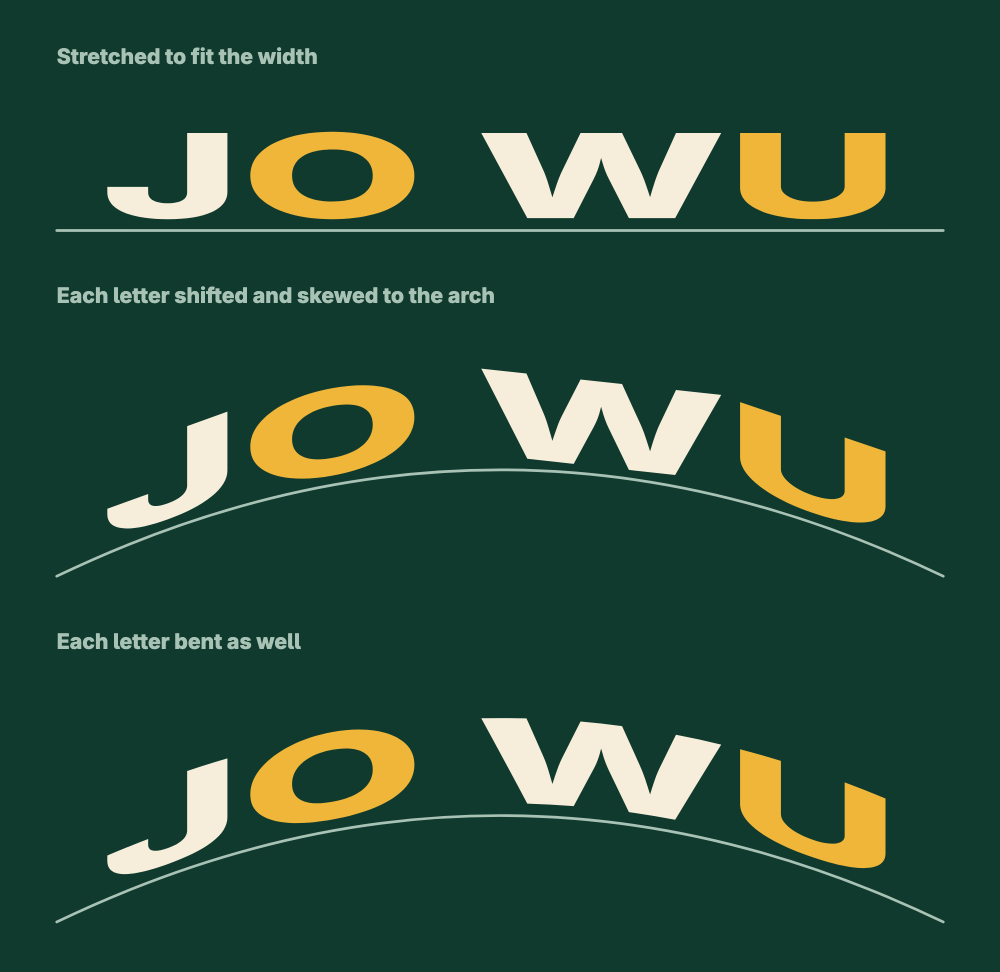
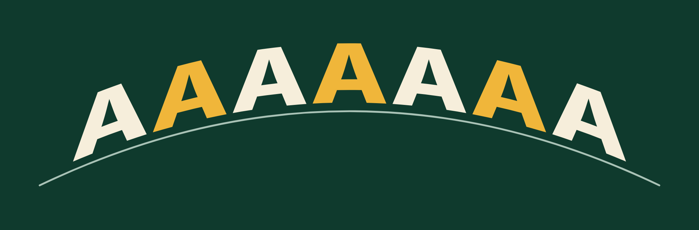
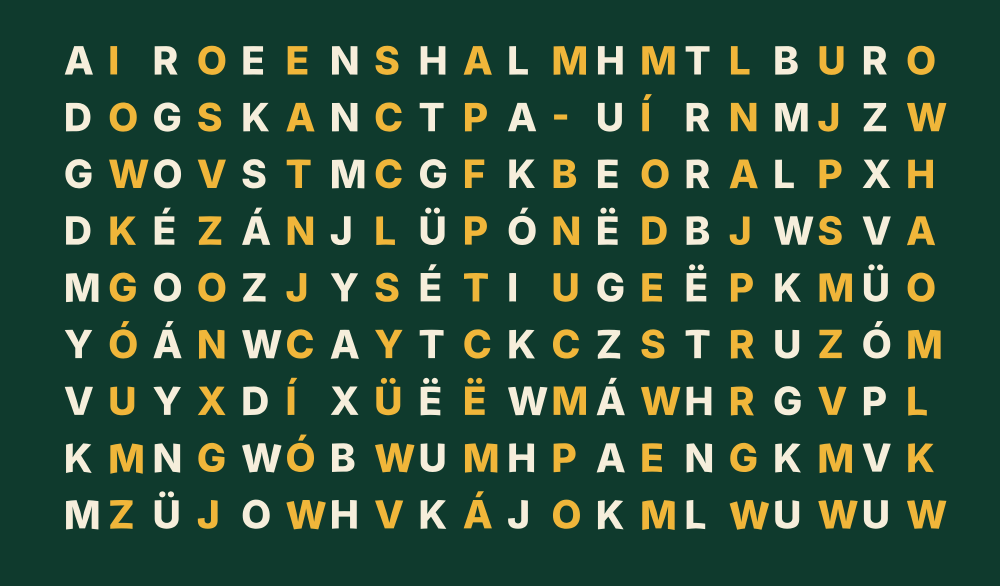
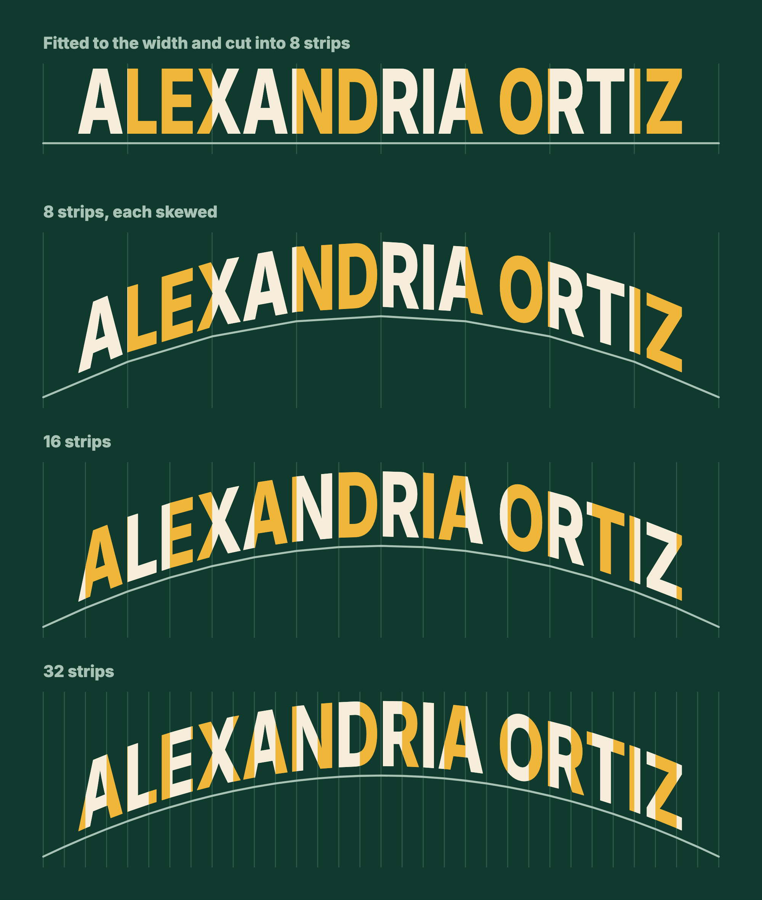

# Arched text in a PDF

PDF lets you scale, skew and rotate text, but it doesn't let you bend it. So when a design calls for an envelope warp, such as a name on an arch, layout tools usually convert the text to outlines. For a single headline, the extra outline costs little. In variable-data printing, where every piece in a mail run carries a different name, outlining means a new vector shape for every recipient and a much larger file.

This repo draws each name one letter at a time, and every letter is an outline that the whole job shares. The file stores a few hundred letter shapes, not one shape per name. Each card also carries its name as ordinary text, so you can still find the name and copy it.



The example is a run of 250 season cards for a fictional football club. Every card has a different name, fitted to the same width. I built it with [Format](https://format.dev), which paginates documents written in React and CSS into PDFs. Format also stores a repeated outline once, however many times a document draws it.

## How it works

An arch moves each point of a name up by a different amount. For a single letter, that movement is a shift, a skew and a bend:

- **Shift:** the whole letter moves up to the height of the arch at the letter's middle.
- **Skew:** the letter slants to match the slope of the arch at its middle.
- **Bend:** the letter's outline curves, because the arch goes on curving across the letter's width.



A PDF matrix can shift and skew a shape, so the document places every letter with a matrix. A matrix can't bend a shape, so the bend has to be drawn into the letter's outline.

### Why letters can share an outline

A letter bends by the same amount wherever it sits on the arch, so one bent outline serves every position in a name.

This arch is a parabola, and a parabola curves by the same amount along its whole length. A piece of the parabola near one end is the same shape as a piece in the middle, only shifted and skewed, and the matrix already shifts and skews.

This picture places one outline of an "A" seven times, and only the matrix changes from one to the next:



One "A" isn't enough for a whole job, though, because names are stretched by different amounts to fit the width. A short name is stretched wide, so each of its letters spans more of the arch and has to curve more. A long name is squeezed, and its letters curve less. The bend depends only on the stretch, so names that are stretched about the same can share their letters.

To let more names share, each bend is rounded to the nearest of a fixed set of steps, spaced so that the rounding never moves the edge of a letter by more than 0.02 mm. A narrow letter such as "I" hardly bends, so 2 outlines cover every "I" on these cards. A wide letter such as "W" needs 12.

### How many outlines a job needs

The 250 cards draw 3,317 letters from 180 distinct outlines. The "A" is drawn 393 times from 8 outlines, and the "I" is drawn 189 times from 2. This picture shows all 180:



A job with a hundred times as many names needs about twice as many outlines. I counted the outlines that random names of the same lengths would need:

| Names   | Letters drawn | Distinct outlines |
| ------- | ------------- | ----------------- |
| 1,000   | 15,982        | 218               |
| 10,000  | 160,755       | 351               |
| 100,000 | 1,598,360     | 453               |

## The code

The geometry is in [`arch.ts`](arch.ts), which reads the glyph outlines from the font with [fontkit](https://github.com/foliojs/fontkit), shapes each name, and returns one bent outline and one matrix for every letter. Besides the Format SDK, it needs `fontkit` and `@format.dev/fonts`, which is where it reads Format Sans from.

The document in [`season-cards.tsx`](season-cards.tsx) draws each letter as an SVG path:

```tsx
function Name({ member }: { member: Member }) {
  return (
    <div className="name">
      <p className="name-text">{member.name}</p>

      <svg viewBox="0 0 1000 334" aria-hidden="true">
        <path className="ribbon" d={RIBBON} />
        <path className="piping" d={PIPING} />

        {archedLetters(member.lettering).map((letter, index) => (
          <path key={index} d={letter.outline} transform={letter.transform} />
        ))}
      </svg>
    </div>
  )
}
```

Nothing in the document asks for the outlines to be shared. For two letters that bend alike, `archedLetters` returns the very same path data, and Format stores a repeated path once in the PDF.

The rounding that makes letters bend alike is three lines:

```ts
// a wide glyph shows a small change in bend more than a narrow one
// does, so its steps are finer
const step = (4 * inEm(BEND_TOLERANCE_MM)) / reach ** 2
const rung = Math.round(neededBend / step)
const bend = rung * step
```

## Keeping the name findable

The arched letters are artwork, so on their own they would leave a card with no name that a PDF viewer could find. The document therefore writes the name a second time, as the paragraph at the top of the component above.

That paragraph is the same colour as the ribbon and lies underneath it. Because the ribbon is arched, only one horizontal band is covered by it from end to end, and the paragraph sits inside that band. The paragraph doesn't show on any of the 250 cards.

Searching for a name finds the hidden paragraph, and copying a name copies it. The picture is marked `aria-hidden`, which keeps the artwork out of the PDF's tag tree and leaves the paragraph to stand in for it.

## What ends up in the PDF

Format stores a shared outline once, as a form XObject. This is the start of the form for the "A" on the first card:

```
0 0 m
80.89 -243.82 161.79 -487.2 242.68 -730.14 c
319.66 -730.55 396.64 -730.57 473.63 -730.18 c
556.96 -487.25 640.3 -243.86 723.63 0 c
```

The card places that "A" with two lines: a matrix that stretches, skews and positions the letter, and a call that draws the form.

```
.2210276 -.088118464 0 .32339838 247.51 830.22 cm
q 1 0 0 1 22.95 2.92 cm /GTs1 Do Q
```

The name on that card, "ALEXANDRIA ORTIZ", draws `/GTs1` three times, each time under a different matrix.

The PDF holds 124 of these forms, and they draw 2,941 of the 3,317 letters. Format writes a form only where it makes the file smaller. An outline that is drawn only once, or one as short as the rectangle of an "I", is written in full where it is drawn.

## How the file sizes compare

The `pdf` folder holds the same 250 cards drawn four ways. The names average 14 characters.

| Names drawn as         | File                                | Size    | Added per name |
| ---------------------- | ----------------------------------- | ------- | -------------- |
| Plain text, no warp    | `season-cards-plain-text.pdf`       | 0.48 MB |                |
| Shared letter outlines | `season-cards-arched.pdf`           | 0.65 MB | 0.5 KB         |
| Text in 32 strips      | `season-cards-arched-32-strips.pdf` | 1.00 MB | 2.1 KB         |
| One outline per name   | `season-cards-outlined.pdf`         | 1.99 MB | 6.0 KB         |

With shared outlines, a typical card adds 0.3 KB for its name, and the most expensive card adds 2.4 KB. With an outline per name, every letter adds to the cost, which runs from 1.3 KB to 12 KB in this set.

To get the average cost per name, I rendered each version at 50 cards and at 250, divided the growth in file size by 200, and subtracted the same figure for plain text. The ranges come from comparing each page with the same page in the plain-text file.

I generated the outlines for the last row myself and kept them compact, with one curve for each straight edge of a glyph and coordinates to one decimal place. A layout tool's warp might write heavier outlines.

## How accurate it is

Measured on renders at 1800 dpi, the arched letters stay within 0.03 mm of a true warp everywhere, and within 0.003 mm on average.

For that measurement, I rendered the names with the arch and without it. One pixel at 1800 dpi is 0.014 mm. This arch moves every point straight up by an amount that depends only on the point's horizontal position, so shifting each pixel column of the flat render gives the true warp to compare against.

Rounding a bend to a step moves the edge of a letter by 0.02 mm at most, and redrawing a curved edge as cubic curves moves it by 0.001 mm at most. Both limits are constants in `arch.ts`. A smaller bend limit produces more distinct outlines, and a smaller curve limit produces more segments in each outline.

## Limitations

The arched letters are artwork, not text. Selecting a name in a viewer selects the hidden paragraph, so the highlight runs along the middle of the ribbon and not over the letters. Poppler, MuPDF and PDFKit all read the name from the hidden paragraph, and a search in PDFKit finds it. I haven't tried Acrobat.

None of these files has been through a RIP. The measurements above come from MuPDF and Poppler, and a press RIP is a different renderer. Run a sample through yours before you commit a job to it.

The arch is the only warp built here. Another warp would need each letter bent to the curve at its own position.

Every name is fitted to the same width, whatever its length. In this set, "LI WU" is stretched to 2.4 times its natural width, and the longest name is squeezed to a third.

The helper reads TrueType outlines only, so it rejects a font with PostScript outlines. Your font's licence also has to allow outlined text.

## If the letters themselves have to be text

A second way to build the arch keeps the visible letters as text in the embedded font. It cuts the name into narrow vertical strips and skews each strip to follow the arch, using nothing but SVG and CSS:



The strip version of the document is [`season-cards-strips.tsx`](season-cards-strips.tsx), and the `pdf` folder has its output at 16 and 32 strips. At 16 strips, a name adds 1.1 KB, about twice what shared outlines add, and stays within 0.10 mm of a true warp. At 32 strips, a name adds 2.1 KB and stays within 0.03 mm.

Each strip redraws the letters it crosses, so a PDF viewer finds repeated or out-of-order letters where the name is. On screen, anti-aliasing can also leave faint marks where two strips meet.

## About Format

[Format](https://format.dev) produced every PDF in this repo. You write a document in React and CSS, and Format paginates it into a PDF. The [Format docs](https://format.dev/docs) explain how documents like these are written and rendered.

I work on Format, which is why the example is built with it. The geometry doesn't depend on Format: any tool that can draw a shape once and place it many times can use the same construction. With Format, the sharing happens without the document asking for it.
